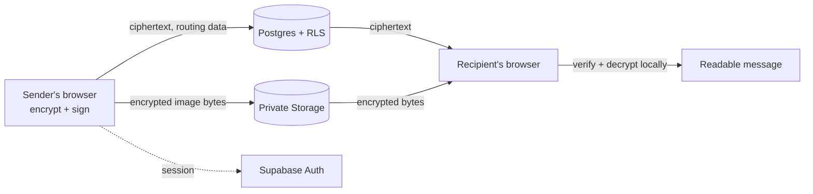

<h1>
  
  Sloppy Chat
</h1>

Sloppy is an end-to-end encrypted chat platform. Messages and images are encrypted in your browser with AES-256-GCM. Message keys are wrapped using ECDH P-256 and HKDF-SHA-256, and messages are signed with ECDSA P-256. Supabase provides account sessions, encrypted message routing, trusted-device approvals, and private storage for encrypted images.

Free to use, modify, and redistribute under the [MIT License](LICENSE). Source code: [github.com/nari442/SloppyChat](https://github.com/nari442/SloppyChat).

[](https://react.dev/)
[](https://www.typescriptlang.org/)
[](https://supabase.com/)
[](LICENSE)

## How it works

1. Create an account with a generated 12-character handle, a strong password, and an optional preferred name. The preferred name defaults to the handle.
2. Approve each new browser from an existing trusted device.
3. Accept message requests before opening direct conversations, and verify safety codes before sending.
4. Messages are encrypted and signed in the browser. Image files are encrypted before upload to a private Storage bucket.
5. Manage theme, notifications, blocked users, devices, and conversation history from the app.

Share a direct-chat link such as `https://sloppychat.vercel.app/ccq42t7rpzea`. After sign-in, it opens a prefilled request composer. The sender chooses the first message and confirms before sending.



## Quick start

### Requirements

- Node.js 22.12 or newer, and npm
- A Supabase project with Auth, Postgres, Realtime, and Storage enabled
- Email confirmation **disabled** in Supabase Auth. Handles map to synthetic `@auth.sloppy.chat` aliases, which are not real addresses.

### 1. Install

```sh
npm install
```

### 2. Configure

Set these in your local environment (for example `.env.local`) or your hosting provider:

| Variable | Value |
| --- | --- |
| `VITE_SUPABASE_URL` | Your Supabase project URL |
| `VITE_SUPABASE_PUBLISHABLE_KEY` | The publishable/anon key |

> [!WARNING]
> Only the publishable/anon key belongs in browser configuration. Never put a service-role key in a `VITE_` variable.

### 3. Prepare the database

The app requires the existing Sloppy schema and RLS policies. The original bootstrap files are not included in this repository.

For an existing Sloppy deployment, run `database/005_display_names.sql` once in the Supabase SQL Editor. It backfills current profiles and adds the secure preferred-name update function. Refresh the PostgREST schema if prompted.

### 4. Run

```sh
npm run dev
```

## Scripts

| Command | Description |
| --- | --- |
| `npm run dev` | Start the dev server |
| `npm test` | Run tests |
| `npm run lint` | Lint |
| `npm run build` | Production build into `dist/` |

## Usage notes

**Settings:** system/light/dark appearance, password changes, notification preferences, blocked users, trusted devices, and message-request approvals.

**Conversation actions:** local renaming, hiding a conversation from your list, clearing your visible history, blocking participants, and deleting a direct conversation for both participants. A single member cannot delete group history for everyone.

**Images:** up to 2 MB per original file. Accepted formats are PNG, JPEG, WebP, GIF, and AVIF. SVG is rejected. Bytes are decrypted only in the browser.

## Security model

### What is protected

- Message text and attachment keys are encrypted and signed in the browser. Supabase stores ciphertext, encrypted image blobs, and the metadata needed for routing.
- Conversation membership, blocking, device approval, and Storage access are enforced by RLS and database functions.
- Notifications are opt-in, stored per browser, and contain no message text. There is no background push.

### What is not

- **Compromised clients.** A compromised browser, malicious extension, or injected script can read plaintext while Sloppy is open. End-to-end encryption does not cover this.
- **No account recovery.** If you lose all approved devices, existing encrypted history can become inaccessible. There is no email recovery path.
- **Visible metadata.** Participants, timestamps, message sizes, and routing data are visible to the Supabase project.
- **Copied data.** Blocking restricts access in the app but cannot retract data another participant already copied.

Before publishing a project, review Supabase Auth settings, database policies, public configuration, and deployment logs.

## Deployment

Build with `npm run build` and publish `dist/` to a static host. Set `VITE_SUPABASE_URL` and `VITE_SUPABASE_PUBLISHABLE_KEY` in the host's build environment.

Configure the host to serve `index.html` for single-segment 12-character handle paths such as `/ccq42t7rpzea`. The included `robots.txt` and `sitemap.xml` are copied into `dist/`.

## License

Released under the [MIT License](LICENSE).