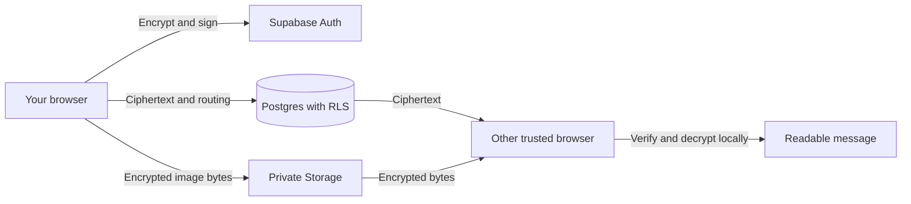

# Sloppy Chat


Sloppy is an end-to-end encrypted chat platform. Messages and images are encrypted in your browser with AES-256-GCM; message keys are wrapped using ECDH P-256 and HKDF-SHA-256, and messages are signed with ECDSA P-256. Supabase provides account sessions, encrypted message routing, trusted-device approvals, and private storage for encrypted images.

[](https://react.dev/)
[](https://www.typescriptlang.org/)
[](https://supabase.com/)

## How It Works

1. Create an account with a generated 12-character handle and a strong password.
2. Approve each new browser from an existing trusted device.
3. Accept message requests before opening direct conversations; verify safety codes before sending.
4. Messages are encrypted and signed in the browser. Image files are encrypted before upload to a private Storage bucket.
5. Manage theme, notifications, blocked users, devices, and conversation history from the app.



## Requirements

- Node.js 22.12 or newer and npm.
- A Supabase project with Auth, Postgres, Realtime, and Storage enabled.
- Email confirmation disabled for password-only registration. Handles map to synthetic `@auth.sloppy.chat` aliases; these are not real email addresses.

## Local Development

```sh
npm install
npm run dev
```

Set `VITE_SUPABASE_URL` and `VITE_SUPABASE_PUBLISHABLE_KEY` in your local environment or hosting provider. Use only the Supabase publishable/anon key in browser configuration. Never use a service-role key in a `VITE_` variable.

Apply the migrations in order with the Supabase CLI:

```sh
npx supabase login
npx supabase link --project-ref YOUR_PROJECT_REF
npx supabase db push
```

## Security Notes

- Message text and attachment keys are encrypted and signed in the browser. Supabase stores ciphertext, encrypted image blobs, and the metadata needed to route conversations.
- Conversation membership, blocking, device approval, and Storage access are guarded by RLS and database functions. Apply all migrations before exposing the app.
- Browser notifications contain no message text and are opt-in. The preference is stored per browser. The app does not implement background push.
- A compromised browser, malicious browser extension, or injected script can access plaintext while Sloppy is open. End-to-end encryption does not protect a compromised client.
- The local signing key is held in the browser's IndexedDB vault. Losing all approved devices can make the account's existing encrypted history inaccessible; there is no email recovery path.
- Conversation participants, timestamps, message sizes, and routing metadata are visible to the Supabase project. Blocking prevents app-level access but cannot retract data already copied by another participant.
- Review Supabase Auth settings, database policies, Edge Function secrets, and deployment logs before publishing a project.

## Account and Conversation Controls

Settings include system/light/dark appearance, password changes, browser-notification preferences, blocked-user management, and trusted-device/message-request approvals.

Conversation actions include local renaming, hiding a conversation from your list, clearing your visible history, blocking participants, and deleting a direct conversation for both participants. Group history cannot be deleted for everyone by a single member.

Images are limited to 2 MB per original file. Only PNG, JPEG, WebP, GIF, and AVIF are accepted; SVG is rejected. Image bytes are encrypted before upload and decrypted only in the browser.

## Checks

```sh
npm test
npm run lint
npm run build
```

## Deployment

Build with `npm run build` and publish the generated `dist/` directory to a static host. Configure the two `VITE_` variables in the host's build environment and apply the Supabase migrations before exposing the app.

## License

No license has been selected yet. Add the license you intend to publish under before accepting outside contributions.
