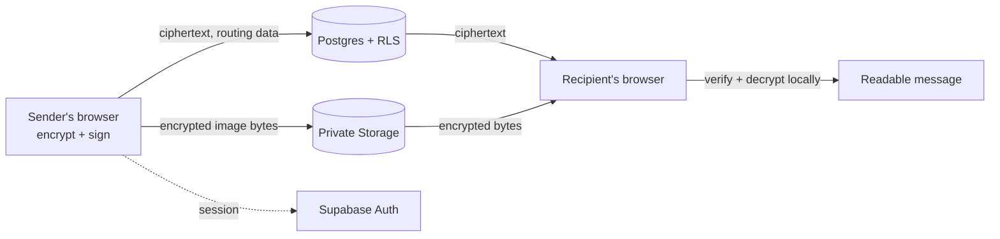

<p align="center">
  
</p>

<h1 align="center">Sloppy Chat</h1>

<p align="center">
  End-to-end encrypted chat in the browser. Supabase only ever sees ciphertext.
</p>

<p align="center">
  <a href="https://react.dev/"></a>
  <a href="https://www.typescriptlang.org/"></a>
  <a href="https://supabase.com/"></a>
</p>

---

## Overview

Sloppy is a chat platform where encryption and signing happen entirely client-side. Supabase handles account sessions, message routing, trusted-device approvals, and private storage for encrypted images. It never holds plaintext or usable keys.

- **Direct and group conversations** with message requests and safety-code verification
- **Encrypted images** (PNG, JPEG, WebP, GIF, AVIF), encrypted before upload
- **Trusted devices:** every new browser must be approved by an existing one
- **Password-only accounts** with generated 12-character handles, no email required
- **Opt-in notifications** that never contain message text

## Cryptography

| Purpose | Primitive |
| --- | --- |
| Message and image encryption | AES-256-GCM |
| Message key wrapping | ECDH P-256 with HKDF-SHA-256 |
| Message signing | ECDSA P-256 |

All operations use the browser's Web Crypto API. The signing key lives in the browser's IndexedDB vault.

## How it works

1. Create an account with a generated handle and a strong password.
2. Approve each new browser from an existing trusted device.
3. Accept a message request, then verify the safety code before sending.
4. Messages are encrypted and signed in the browser. Images are encrypted before they reach the private Storage bucket.
5. Manage theme, notifications, blocked users, devices, and history from the app.



## Quick start

### Requirements

- Node.js 22.12 or newer, and npm
- A Supabase project with Auth, Postgres, Realtime, and Storage enabled
- Email confirmation **disabled** in Supabase Auth. Handles map to synthetic `@auth.sloppy.chat` aliases, which are not real addresses.

### 1. Install

```sh
npm install
```

### 2. Configure

Set these in your local environment (for example `.env.local`) or your hosting provider:

| Variable | Value |
| --- | --- |
| `VITE_SUPABASE_URL` | Your Supabase project URL |
| `VITE_SUPABASE_PUBLISHABLE_KEY` | The publishable/anon key |

> [!WARNING]
> Only the publishable/anon key belongs in browser configuration. Never put a service-role key in a `VITE_` variable.

### 3. Apply migrations

```sh
npx supabase login
npx supabase link --project-ref YOUR_PROJECT_REF
npx supabase db push
```

Migrations are applied in order. They set up the RLS policies and database functions that guard conversations, blocking, device approval, and Storage access, so run them before exposing the app.

### 4. Run

```sh
npm run dev
```

## Scripts

| Command | Description |
| --- | --- |
| `npm run dev` | Start the dev server |
| `npm test` | Run tests |
| `npm run lint` | Lint |
| `npm run build` | Production build into `dist/` |

## Usage notes

**Settings:** system/light/dark appearance, password changes, notification preferences, blocked users, trusted devices, and message-request approvals.

**Conversation actions:** local renaming, hiding a conversation from your list, clearing your visible history, blocking participants, and deleting a direct conversation for both participants. A single member cannot delete group history for everyone.

**Images:** up to 2 MB per original file. Accepted formats are PNG, JPEG, WebP, GIF, and AVIF. SVG is rejected. Bytes are decrypted only in the browser.

## Security model

### What is protected

- Message text and attachment keys are encrypted and signed in the browser. Supabase stores ciphertext, encrypted image blobs, and the metadata needed for routing.
- Conversation membership, blocking, device approval, and Storage access are enforced by RLS and database functions.
- Notifications are opt-in, stored per browser, and contain no message text. There is no background push.

### What is not

- **Compromised clients.** A compromised browser, malicious extension, or injected script can read plaintext while Sloppy is open. End-to-end encryption does not cover this.
- **No account recovery.** If you lose all approved devices, existing encrypted history can become inaccessible. There is no email recovery path.
- **Visible metadata.** Participants, timestamps, message sizes, and routing data are visible to the Supabase project.
- **Copied data.** Blocking restricts access in the app but cannot retract data another participant already copied.

Before publishing a project, review Supabase Auth settings, database policies, Edge Function secrets, and deployment logs.

## Deployment

Run `npm run build` and publish `dist/` to any static host. Set the two `VITE_` variables in the host's build environment, and apply the Supabase migrations before going live.

## License

No license has been selected yet. Choose one before accepting outside contributions.
